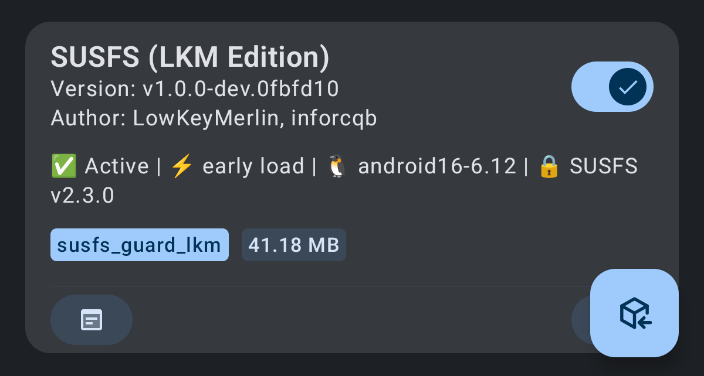
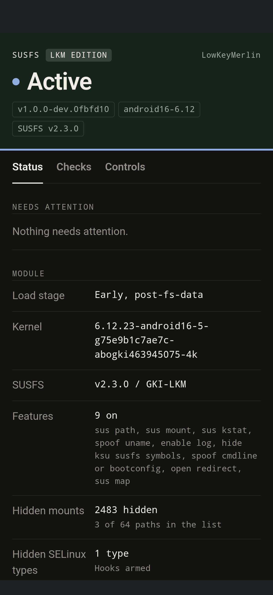
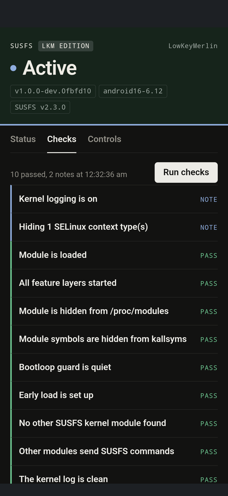
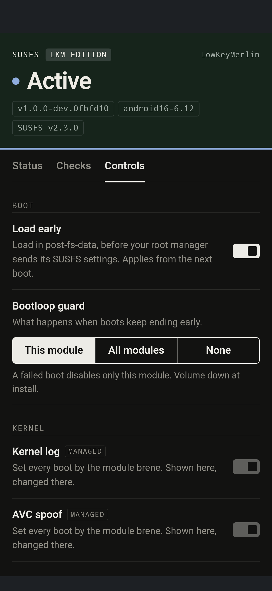
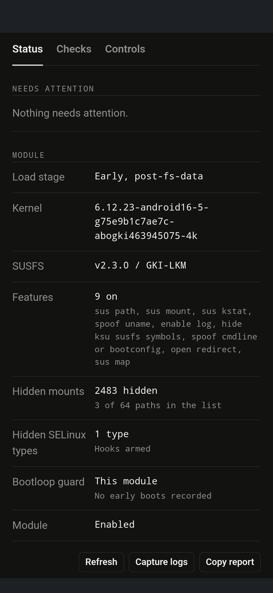
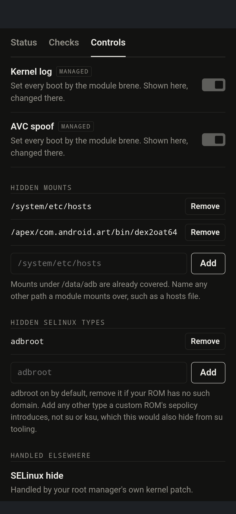

# SUSFS for KernelSU (LKM Edition)

[](https://github.com/LowKeyMerlin/susfs4ksu-lkm/actions/workflows/susfs-pipeline.yml)
[](https://github.com/LowKeyMerlin/susfs4ksu-lkm/releases)
[](../LICENSE)

[SUSFS](https://gitlab.com/simonpunk/susfs4ksu) as a loadable kernel module. It loads into the
kernel you already run, next to KernelSU. No kernel build and no SUSFS patches, so you keep your
own kernel and your vendor's optimizations and still get SUSFS.

<p align="center">
  
</p>

[Install](#install) | [WebUI](#webui) | [Loading](#loading) | [Boot guard](#boot-guard) | [Built-in or LKM](#built-in-susfs-or-lkm) | [Compatibility](#compatibility) | [Reporting a problem](#reporting-a-problem) | [Development](#development) | [Credits](#credits)

> [!CAUTION]
> The module runs inside the kernel. A bad build or a wrong `.ko` can leave a device in a bootloop.
> Keep the boot guard on, keep your stock boot image (`init_boot.img`, or `boot.img` on older
> devices) and read [Boot guard](#boot-guard) before you flash.

## Highlights

* **SUSFS without a kernel build.** Path, mount, kstat and memory map hiding, open redirect,
  uname and cmdline spoofing, AVC log spoofing and hidden KernelSU symbols. Where a hook differs
  from the upstream kernel patch, `.susfs-fork/parity.json` says how.
* **WebUI in the manager.** Load status, health checks, boot guard settings and the lists of hidden
  mounts and SELinux types, without a shell.
* **Boot guard.** Disables the module when boots do not finish, so a bad load does not repeat.
* **Early load by default.** The module is up before other modules run their `post-fs-data`
  scripts, so settings sent from there reach it. It can load later, or by hand on a running system.
* **No background threads or polling.** Delayed work runs on an event only: a retry every 2 s, up
  to 60 times, for a hidden path whose file does not exist yet, and one pass a second after
  `packages.list` changes.
* **Tested before it merges.** Every change is built, booted in QEMU on each kernel, run against the
  KernelSU forks and run on an Android guest (Cuttlefish).

This is a fork of [inforcqb/susfs4ksu-lkm](https://github.com/inforcqb/susfs4ksu-lkm). It adds the
boot guard, the WebUI, fixes found by booting real kernels, the upstream SUSFS changes as they
stabilize, and a CI pipeline that every change has to pass.

## Install

Needs an arm64 device with KernelSU or one of its forks, already up and running.

1. Download `ksu_susfs_lkm-module-<tag>-arm64.zip` from
   [Releases](https://github.com/LowKeyMerlin/susfs4ksu-lkm/releases), or from the artifacts of the
   latest successful `susfs-pipeline` run.
2. Flash it in the KernelSU manager and reboot. The installer shows the device check, the kernel
   build it picked and the boot guard choice, and writes `/data/adb/susfs_guard_lkm-install.log`.
   It refuses a manager that is not KernelSU.
3. Add rules through the `/proc/susfs_*` nodes, see [PROC_INTERFACES.en.md](../PROC_INTERFACES.en.md).
   Managers that speak SUSFS do this for you.

If the kernel already has SUSFS built in, the module stands by and does not load a second copy.

To remove it, disable the module in the manager, or run `rmmod susfs_guard_lkm` to unload it immediately.

## WebUI

Open it from the module's entry in the manager. It has three tabs.

<table>
  <tr>
    <td align="center"></td>
    <td align="center"></td>
    <td align="center"></td>
  </tr>
  <tr>
    <td align="center">Status</td>
    <td align="center">Checks</td>
    <td align="center">Controls</td>
  </tr>
  <tr>
    <td align="center"></td>
    <td></td>
    <td align="center"></td>
  </tr>
</table>

* **Status** shows the load stage, the kernel, the SUSFS version, the enabled features, the number
  of hidden mounts and the guard state. **Capture logs** writes one report to `/sdcard/Download`,
  and **Copy report** copies it.
* **Checks** runs the health checks: the module is loaded, every layer started, the module is
  hidden from `/proc/modules` and kallsyms, the guard is quiet, early load is set up, no other SUSFS
  kernel module is present, and the kernel log has no hook failures. Each result is `PASS`, `NOTE`,
  `WARN` or `FAIL`, and a failing one says what to do.
* **Controls** switches early load, picks what a guard trip disables, and edits the lists of hidden
  mounts and hidden SELinux types. The kernel log and AVC spoof switches are marked `MANAGED` when
  another module sets them at every boot. They are then shown but not offered, since the next boot
  would override a change.

Mounts under `/data/adb` are hidden without being listed. The mount list is for other bind mounts,
such as a hosts file. `adbroot` is the one SELinux type hidden by default. Remove it if your ROM has
no such domain.

## Loading

| Stage | How |
| --- | --- |
| `post-fs-data.d` | Default. Runs before the `post-fs-data` script of any module. |
| `post-fs-data` | Turn **Load early** off in the WebUI, or run `early.sh off` and reboot. |
| Manual | `ksud insmod <ko>`, or `susfs_insmod <ko>` without KernelSU. |

A manager that sends SUSFS settings from its own `post-fs-data` script (brene and similar) needs
the default, or the settings reach a kernel with no SUSFS and are lost. Rules and kstat snapshots
also exist before other modules mount.

To switch without the WebUI, run `/data/adb/modules/susfs_guard_lkm/early.sh off` and reboot to
load at `post-fs-data`. `early.sh on` turns it back on, and a module update keeps the choice.

The loader writes its outcome to `load.log` in the module folder and gives up after one minute. A
timed-out load leaves `/data/adb/susfsload_timeout.log` and, with the kernel log from the start of
the load, `/data/adb/susfsload_timeout_dmesg.log`.

<details>
<summary>Loading manually</summary>

```sh
ksud insmod /data/adb/loader/susfs_guard_lkm.ko    # KernelSU
susfs_insmod /data/adb/loader/susfs_guard_lkm.ko   # no KernelSU
rmmod susfs_guard_lkm                              # unload
```

Use the `.ko` that matches the kernel, for example `susfs_guard_lkm-android13-5.15.ko`.

</details>

## Boot guard

The guard sets a marker before the module loads and clears it once the boot has been up for ten
minutes. If the marker is still there at the next boot, that boot ended early. It counts against
the module unless someone asked for the end. A reboot or power-off from the menu, the manager or
adb is never counted, however often you do it. A power cut, a panic or a forced power-off is.
Two in a row disable the module instead of loading it again. A cut-off boot more than an hour old
no longer counts.

The guard tells the two apart by two signals that do not depend on each other: the shutdown it saw
begin, and the boot reason Android reports. Both have to be missing for a boot to count.

It also watches for a crash loop that never reboots. If zygote or SystemUI restart four times
while the boot is being watched, it disables the module and reboots.

What a trip disables is chosen at install with the volume keys, and later in the WebUI.

| Scope | A trip disables |
| --- | --- |
| All modules | Every KernelSU module. Default. |
| This module | Only this one. |
| None | Nothing. The boot watch is off. |

Magisk and APatch are not tested.

<details>
<summary>The device still does not boot</summary>

* Boot into KernelSU's safe mode, which loads no module. Its documentation gives the key sequence.
* Create `/data/adb/susfs_skip` from adb or recovery to keep this module from loading. Delete it to
  load again.
* Or delete `/data/adb/modules/susfs_guard_lkm`. The module is gone on the next boot.

</details>

## Built-in SUSFS or LKM

|  | Built-in SUSFS kernel | SUSFS as an LKM (this module) |
| --- | --- | --- |
| Setup | Patch KernelSU and the kernel, build, flash a boot image or an AnyKernel3 zip. Often a GKI kernel built from Google's artifacts. | KernelSU in LKM mode patches the boot partition your device uses, `init_boot` on newer devices and `boot` on older ones. This module is then installed like any KernelSU module. |
| Kernel | Replaced by your build. | Left as it is. |
| Hooks | Patched into the kernel source. No dependency on kprobes. | kprobes, syscall table wrappers and kallsyms lookups. Where they differ from upstream is listed in `.susfs-fork/parity.json`. |
| Active from | The start of boot. | `post-fs-data.d` by default, or `post-fs-data` with early load off. |
| Updating SUSFS | New kernel build and flash. | Replace the module. |
| After an OTA | The kernel is replaced and has to be flashed again. | The module is in `/data/adb/modules` and is not part of the boot image. |
| Removing | Flash another kernel. | `rmmod`, or disable the module in the manager. |
| Needs | A kernel you can build and flash. Patches can differ per kernel version. | A module build for the kernel version (KMI), and kprobes, kallsyms and module loading enabled. |
| Devices | Works where a replacement kernel can be flashed, including Samsung with KNOX, where KernelSU's LKM mode does not work. | Needs KernelSU to run on the stock kernel. |
| Best when | You build your own kernel and want every upstream hook. | You keep the stock kernel, or want to update without flashing a kernel. |

> [!NOTE]
> KernelSU's own LKM and GKI modes are unrelated to this table. They describe how KernelSU gets
> into the kernel, while the table is about how SUSFS gets in. The module needs KernelSU running on
> the kernel and asks it which callers are apps, at every call.

## Compatibility

A kernel works if a module build matches its version and KernelSU supports the kernel. The device
does not have to be GKI supported, and the kernel does not need SUSFS patches.

The zip carries one `.ko` per kernel build and the installer picks the one that matches
`/proc/sys/kernel/osrelease`. To force a different one, write its name into `kmi_override` in the
module folder.

| Android | Kernel |
| --- | --- |
| 12 | 5.10 |
| 13 | 5.10, 5.15 |
| 14 | 5.15, 6.1 |
| 15 | 6.6 |
| 16 | 6.12 |
| 17 | 6.18 |

* What KernelSU supports: its [README](https://github.com/tiann/KernelSU#compatibility-state) and
  [installation guide](https://kernelsu.org/guide/installation.html).
* The module is tested with the forks in [`ksud_forks.json`](../.susfs-fork/ksud_forks.json),
  among them KernelSU, SukiSU-Ultra, BakaSU and KernelSU-Next.
* Test results per build: [Actions](https://github.com/LowKeyMerlin/susfs4ksu-lkm/actions).

## Reporting a problem

Open an [issue](https://github.com/LowKeyMerlin/susfs4ksu-lkm/issues) with:

* the report from **Capture logs** in the WebUI,
* `/data/adb/susfs_guard_lkm-install.log` for an install that failed,
* `load.log` in the module folder, and the `susfsload_timeout` logs if the load timed out.

## Development

`susfs-dev` follows [simonpunk's SUSFS](https://gitlab.com/simonpunk/susfs4ksu) and brings its
stable features in as loadable-module code. It is not synced with the parent repository after
the first sync, and it edits `kernel/` directly.

| Branch | Content |
| --- | --- |
| `main` | Mirrors the parent repository. Never edited by hand. |
| `susfs-main` | Rebased on `main`. Only adds files, and changes parent files as numbered patches in `.susfs-fork/patches/`. |
| `susfs-dev` | This branch. |
| `test/<item>` | One change under test, deleted after it is squashed onto a module branch. |

* An upstream change taken over is a separate commit that carries the upstream short id in its
  title, so it can be found and dropped on its own.
* Added code and tests are in `.susfs-fork/`. The module scripts are in `module/` and
  `.susfs-fork/module/`.
* Workflows are named `susfs-*`. A push to `susfs-dev` runs the build, the QEMU smoke, the KernelSU
  forks and the Android guest.
* New work is tried on a `test/<item>` branch. A push there runs the build and the QEMU smoke.
  `gh workflow run susfs-pipeline.yml --ref test/<item> -f full=true` adds the KernelSU forks and
  the Android guest. Which stages a branch runs is set in its `.susfs-fork/flow.json`.

The branch rules and every workflow are described in
[branches-and-ci.md](../.susfs-fork/docs/branches-and-ci.md).

## Credits

simonpunk for [SUSFS](https://gitlab.com/simonpunk/susfs4ksu), inforcqb for [susfs4ksu-lkm](https://github.com/inforcqb/susfs4ksu-lkm),
[SukiSU-Ultra](https://github.com/SukiSU-Ultra/SukiSU-Ultra) for `patch_memory`, `lsm_hook` and
`symbol_resolver`, and the KernelSU projects this is tested against.

## License

[GPL-2.0](../LICENSE). For research and study, at your own risk.
